# Hi, I'm Romain

Software engineer. I build local-first tools: note-taking apps, CLI utilities, AI agents.

Curious -> self-motivated -> shipping.

## 🎧 Off the clock

- Art museums & pixel art
- Hardcore techno
- Board games

---

## 🗿 Datalith — from pixel to knowledge

> A local-first Vault where notes, links, and tasks sharpen into a monolith that lasts.

A desktop application for building a private personal encyclopedia from files you own: Markdown notes with live preview, wiki links and graph views, relevance-ranked search, a full todo.txt editor. Available on macOS, Windows and Linux.

| | |
|:--|:--|
| 🖥️ [**datalith-app**](https://github.com/mycelium-build/datalith-app) | Desktop app -> Rust, gpui (Zed's UI framework), Tantivy search |
| 📎 [**datalith-clipper**](https://github.com/mycelium-build/datalith-clipper) | Browser extension -> clips any page into your vault |
| 🌐 [**datalith.work**](https://datalith.work) | Website & docs -> Astro |

<table>
  <tr>
    <td>
      <picture>
        <source
          srcset="./profile/pin-datalith-dark.svg"
          media="(prefers-color-scheme: dark)"
        />
        <source
          srcset="./profile/pin-datalith-light.svg"
          media="(prefers-color-scheme: light), (prefers-color-scheme: no-preference)"
        />
        
      </picture>
    </td>
  </tr>
</table>

---

## 📊 GitHub Stats

<table>
  <tr>
    <td>
      <picture>
        <source
          srcset="./profile/stats-dark.svg"
          media="(prefers-color-scheme: dark)"
        />
        <source
          srcset="./profile/stats-light.svg"
          media="(prefers-color-scheme: light), (prefers-color-scheme: no-preference)"
        />
        
      </picture>
    </td>
    <td>
      <picture>
        <source
          srcset="./profile/top-langs-dark.svg"
          media="(prefers-color-scheme: dark)"
        />
        <source
          srcset="./profile/top-langs-light.svg"
          media="(prefers-color-scheme: light), (prefers-color-scheme: no-preference)"
        />
        
      </picture>
    </td>
  </tr>
</table>
